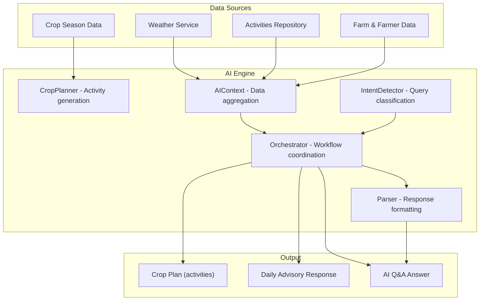

# AI/ML Features

## Overview

FarmMate AI incorporates artificial intelligence and machine learning capabilities, primarily focused on **rule-based planning and context-aware advice generation**. The system is not a learning system - it does not train models on historical data - but rather a **rule-based expert system** that aggregates farm data and generates deterministic recommendations.

## AI Components

### 1. Crop Planner

**Location**: `backend/app/modules/ai_engine/planner.py`

**Purpose**: Generates crop-specific activity plans with scheduling.

**How it works**:
- Takes crop parameters (name, variety, season, land area, soil type, location)
- Generates a sequence of farming activities
- Activities are scheduled relative to the sowing date
- Returns a `CropPlan` object with ordered activities

**Input Parameters**:
- Crop name and variety
- Season (KHARIF/RABI/ZAID)
- Sowing date
- State, district, village location
- Land area and unit
- Soil type

**Output**:
- Ordered list of `Activity` items with:
  - Activity type (land preparation, sowing, etc.)
  - Title and description
  - Scheduled date (relative to sowing)
  - Estimated duration

### 2. Advisor Planner

**Location**: `backend/app/modules/ai_engine/advisor_planner.py`

**Purpose**: Generates daily farming advice based on contextual data.

**How it works**:
- Assembles context from: crop status, weather, activities, soil, location
- Uses rule-based logic to generate recommendations
- Returns `DailyAdvisorResponse` with summary and priority

**Context Assembly** (by `AIContext` class in `context_builder.py`):
- Crop name and variety
- Crop age (days since sowing)
- Soil type (from farm)
- Location (village, district)
- Weather condition (temperature, humidity, rain probability)
- Today's activities titles

**Output**:
- Summary text recommendation
- Priority level (LOW/MEDIUM/HIGH)

### 3. Context Builder

**Location**: `backend/app/modules/ai_engine/context_builder.py`

**Purpose**: Aggregates diverse data sources into a unified AI prompt context.

**Data Sources Combined**:
- Crop season information (name, variety, age)
- Farm soil type and location
- Current weather (from weather service)
- Today's activities (titles and types)
- Crop stage information

**Output Structure** (`AIContext`):
```python
class AIContext:
    crop_name: str
    crop_variety: str | None
    crop_age_days: int
    soil_type: str | None
    location: str
    weather: str  # e.g., "Clear Sky"
    temperature: float
    humidity: int
    rain_probability: int
    today_activities: list[str]
```

### 4. Intent Detector

**Location**: `backend/app/modules/ai_engine/intent_detector.py`

**Purpose**: Classifies user queries in Ask FM into actionable farming intents.

**Intent Categories**:
- Crop planning related
- Activity scheduling
- Weather-related questions
- General farming advice
- Stage-specific questions

**How it works**:
- Analyzes user message text
- Matches against predefined intent patterns
- Routes to appropriate planner/advisor logic

### 5. Orchestrator

**Location**: `backend/app/modules/ai_engine/orchestrator.py`

**Purpose**: Coordinates multi-step AI workflows, potentially combining:
- Crop planning
- Advisor generation
- Recommendation building

**Flow**:
1. Receive user query/request
2. Detect intent
3. Gather relevant context
4. Call appropriate planner
5. Aggregate results
6. Return consolidated response

### 6. Parser

**Location**: `backend/app/modules/ai_engine/parser.py`

**Purpose**: Parses and extracts data from AI responses, ensuring proper formatting.

**Functions**:
- Extract activity data from plan responses
- Parse advisor summary text
- Validate context fields
- Format output for frontend display

### 7. Recommendation Planner

**Location**: `backend/app/modules/ai_engine/recommendation_planner.py`

**Purpose**: Generates crop-specific recommendations (separate from daily advisor).

**Current Status**:
- Basic implementation available
- "Basic recommendation for now. We can make this AI/farming-specific later."
- Currently provides generic weather-based recommendations

### 8. Weather Agent

**Location**: `backend/app/modules/ai_engine/weather_agent.py`

**Purpose**: Weather-aware farming recommendations.

**Integration**:
- Uses current weather conditions
- Combines with crop data for context-aware advice
- Supports rain probability-based recommendations
- Temperature-based heat stress warnings

## AI Workflow Examples

### Example 1: Generate Crop Plan

```text
Input: CropSeason with crop_name="Rice", farm with state="Telangana"
Process:
1. AIEngineService calls CropPlanner.generate_crop_plan()
2. Planner generates activities: LAND_PREPARATION, SOWING, etc.
3. Activities scheduled relative to sowing_date
4. Activities stored in database via ActivityRepository
5. Response returned to caller

Output: Crop plan with 5-7 scheduled activities
```

### Example 2: Get Daily Advisor Advice

```text
Input: Farmer with active crop
Process:
1. AdvisorService.get_today_advice(farmer)
2. Get farmer's primary farm
3. Get active crop season for that farm
4. Calculate crop age (days since sowing)
5. Fetch today's activities for the crop
6. Get current weather for farm location
7. Build AIContext with all data
8. Call AdvisorPlanner.generate_daily_advice(context)
9. Return DailyAdvisorResponse

Output: {"summary": "Today's recommendation: ...", "priority": "MEDIUM"}
```

### Example 3: Ask FM AI Q&A

```text
Input: User message "What should I do about the yellow leaves on my rice?"
Process:
1. ChatService.chat(current_farmer, message)
2. Build context: crop=rice, activities, weather, farm location
3. Use IntentDetector to classify question type
4. Call appropriate planner (possibly AdvisorPlanner)
5. Generate AI response based on context
6. Store message in AskFMMessage
7. Return answer to user

Output: AI-generated farming advice specific to the context
```

## AI Data Flow



## AI/ML Capabilities Table

| Feature | Capability | Technology | Status |
|---------|-----------|-----------|--------|
| Crop planning | Rule-based activity generation | Custom planner (no ML training) | ✅ Implemented |
| Daily advisor | Context-aware recommendations | Rule-based + weather data | ✅ Implemented |
| AI Q&A (Ask FM) | Answer farming questions | Rule-based + context assembly | ✅ Implemented |
| Weather recommendations | Rain/temperature-based advice | Rule thresholds | ✅ Implemented |
| Crop variety recommendations | Not implemented | Would require ML model training | ❌ Not Implemented |
| Predictive yield forecasting | Not implemented | Would require historical data model | ❌ Not Implemented |
| Pest/disease detection from images | Not implemented | Would require computer vision model | ❌ Not Implemented |
| Season prediction | Not implemented | Would require time series model | ❌ Not Implemented |

## Limitations

### Known AI/ML Limitations

1. **No model training**: System does not learn from historical data
2. **Fixed rule set**: Recommendations based on predefined rules and thresholds
3. **No computer vision**: Cannot analyze images (pest/disease from photos)
4. **No predictive analytics**: No yield prediction or season forecasting
5. **Static weather integration**: Uses external API, no long-term forecasting
6. **Simplified context**: Aggregates limited data points for advice generation

### Areas Where AI Could Be Enhanced

1. **ML model integration**: Train on farm-specific historical data
2. **Computer vision**: Image-based pest/disease detection
3. **Predictive modeling**: Yield forecasts, optimal planting dates
4. **Personalized recommendations**: Learn farmer's preferences over time
5. **Long-term weather forecasting**: Integrate with forecasting services
6. **Multi-crop rotation planning**: Optimize crop rotation sequences

## External AI Dependencies

| Dependency | Purpose | Current Usage |
|-----------|---------|---------------|
| **Rule-based planners** | Crop planning, daily advice | Fully implemented |
| **Weather API** | Current conditions, forecasts | Fully integrated (provider pattern) |
| **OpenAI / LLM** | Not currently used | Referenced in code structure but not activated |
| **Embedding models** | Not currently used | No vector storage or similarity search |
| **Training data pipelines** | Not existant | No ML training infrastructure |

---
*AI/ML features documented from codebase analysis as of 2026-11-21. All AI components verified from `backend/app/modules/ai_engine/` source files.*