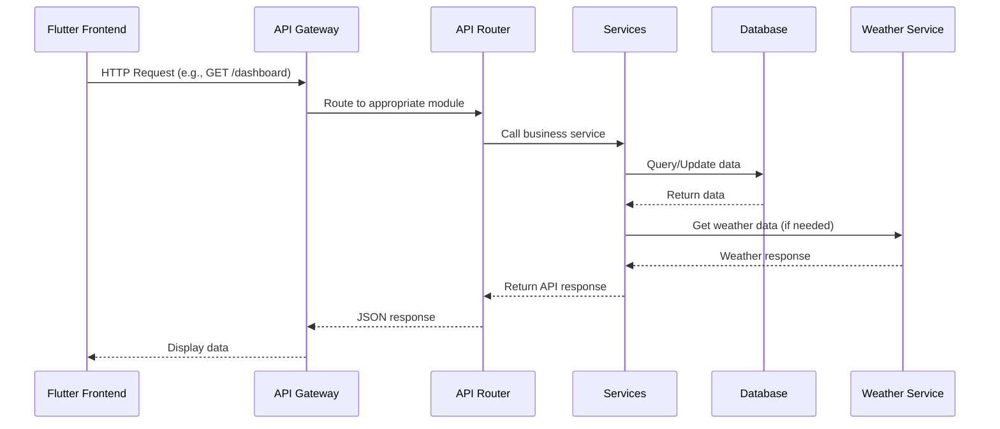
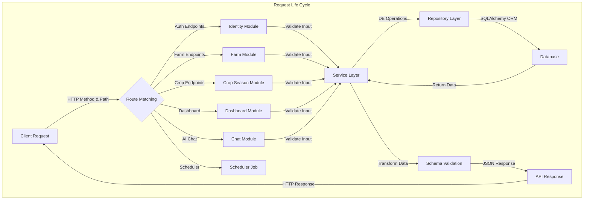
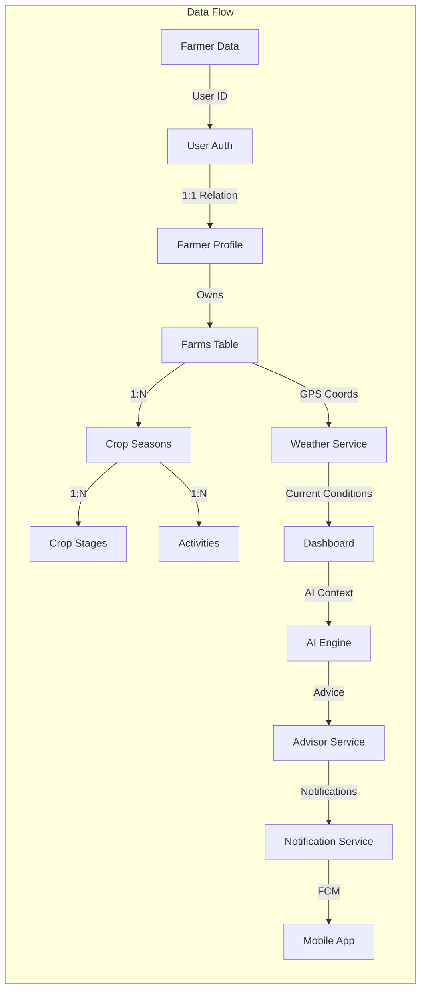
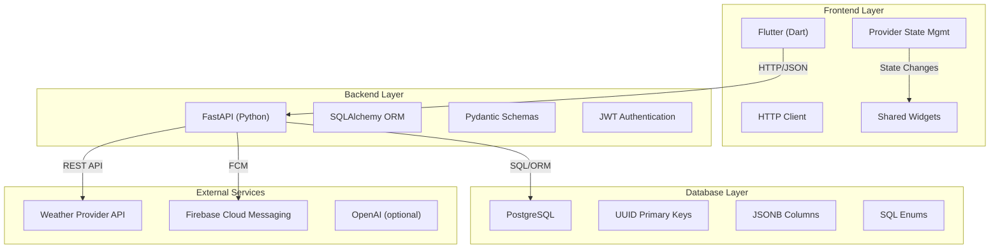
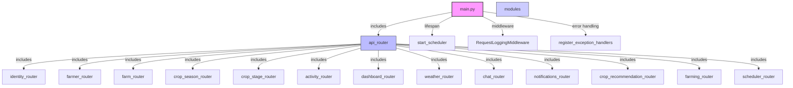

# Architecture

## High-Level Architecture

FarmMate AI follows a **layered client-server architecture** with a clear separation between the Flutter mobile frontend and the Python FastAPI backend.

```mermaid
graph TD
    subgraph Client ["Flutter Mobile App"]
        direction TB
        UI[UI Widgets & Screens]
        Provider[State Management]
        Navigator[Navigation/Routing]
    end

    subgraph Server ["FastAPI Backend"]
        direction TB
        Main[main.py - App Entry Point]
        Router[API Router (v1)]
        Modules[Module Routers]
        Services[Business Services]
        Repositories[Data Repositories]
        Models[SQLAlchemy Models]
        DB[(PostgreSQL)]
    end

    subgraph External ["External Services"]
        WeatherAPI[Weather Provider API]
        FCM[Firebase Cloud Messaging]
    end

    %% Connections
    UI -->|HTTP Requests| Router
    Router -->|Module Routing| Modules
    Modules -->|Service Calls| Services
    Services -->|Repository Calls| Repositories
    Repositories -->|SQLAlchemy ORM| Models
    Models -->|CRUD Operations| DB
    Services -->|API Calls| WeatherAPI
    Services -->|FCM Calls| FCM
    UI -->|Push Notifications| FCM
```

## Component Interactions



## Request-Response Lifecycle



## Data Flow



## Authentication Flow

```mermaid
stateDiagram-v2
    [*] --> Registered: User registers
    Registered --> LoggedIn: User logs in
    LoggedIn --> Authenticated: JWT Token validated
    Authenticated --> Disabled: Account deactivated
    Disabled --> [*]: Login rejected
    
    state "Authenticated Session" as AuthSession {
        [*] --> |JWT Access Token| TokenStore
        TokenStore -->|Token sent with each request| ProtectedEndpoints
        ProtectedEndpoints -->|get_current_user() dependency| UserInfo
        UserInfo -->|Farmer profile access| FarmerData
    }
    
    note right of TokenStore: 
        - HttpOnly cookie or Authorization header
        - Expires in 15 minutes
        - Refresh via re-authentication
    note right of Authenticated: 
        - get_current_user() checks is_active
        - Farmer profile required for most operations
        - Token invalidated on logout
end note
```

## Module Structure

The backend is organized into **independent modules**, each with its own:

- Router (API endpoints)
- Service (business logic)
- Repository (database access)
- Models (SQLAlchemy models)
- Schemas (Pydantic validation)
- Tests

```mermaid
graph TB
    subgraph Modules
        direction TB
        Identity["identity/ - Auth"] 
        Farmer["farmer/ - Farmer profiles"]
        Farm["farm/ - Farm management"]
        CropSeason["crop_season/ - Crop lifecycle"]
        CropStage["crop_stage/ - Crop stages"]
        Activity["activity/ - Farm activities"]
        Dashboard["dashboard/ - Dashboard data"]
        Chat["chat/ - AI Q&A (Ask FM)"]
        Weather["weather/ - Weather integration"]
        AIEngine["ai_engine/ - AI planning"]
        Scheduler["scheduler/ - Background jobs"]
        Notifications["notifications/ - Push notifications"]
    end
    
    Identity -->|includes| MainApp
    Farmer -->|includes| MainApp
    Farm -->|includes| MainApp
    CropSeason -->|includes| MainApp
    CropStage -->|includes| MainApp
    Activity -->|includes| MainApp
    Dashboard -->|includes| MainApp
    Chat -->|includes| MainApp
    Weather -->|includes| MainApp
    AIEngine -->|includes| MainApp
    Scheduler -->|includes| MainApp
    Notifications -->|includes| MainApp
```



## Technology Stack Diagram



## Dependencies Diagram

