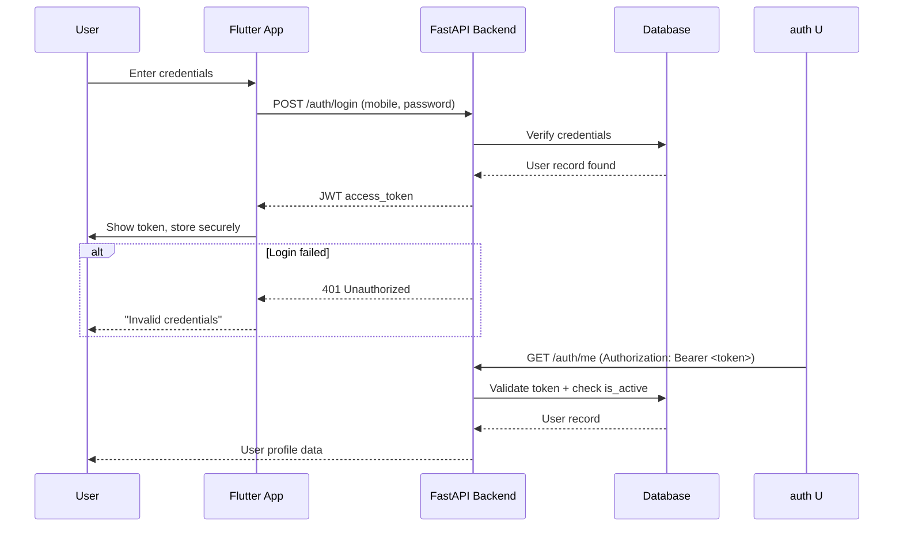

# Authentication & Authorization

## Authentication Strategy

FarmMate AI uses **JWT (JSON Web Token)** based authentication with the following flow:

1. **User registers** via `POST /auth/register`
2. **User logs in** via `POST /auth/login`
3. **JWT token received** in response
4. **Token sent** with `Authorization: Bearer <token>` header on protected endpoints
5. **Token validated** by `get_current_user()` dependency

## User Registration

### Endpoint: `POST /auth/register`

**Purpose**: Create a new user account.

**Authentication**: Public (no token required).

**Request Body**:

```json
{
  "full_name": "John Doe",
  "mobile": "+919876543210",
  "email": "john@example.com",
  "password": "securepassword123"
}
```

**Response**:

```json
{
  "success": true,
  "message": "User registered successfully.",
  "data": {
    "id": "uuid-string",
    "full_name": "John Doe",
    "mobile": "+919876543210",
    "email": "john@example.com",
    "is_active": true
  }
}
```

**Business Rules**:
- Mobile number must be unique across all users
- Email must be unique across all users
- Password is hashed using bcrypt (via `passlib[bcrypt]`)
- Account is created with `is_active=True` by default

## User Login

### Endpoint: `POST /auth/login`

**Purpose**: Authenticate user and receive JWT token.

**Authentication**: Public (no token required).

**Request Body**:

```json
{
  "identifier": "+919876543210",  // Either mobile or email
  "password": "securepassword123"
}
```

**Response**:

```json
{
  "success": true,
  "message": "Login successful.",
  "data": {
    "access_token": "eyJhbGciOiJIUzI1NiIsInR5cCI6IkpXVCJ9...",
    "token_type": "bearer"
  }
}
```

**Authentication Logic**:
- Identifier can be either mobile number or email
- Password is verified against stored `password_hash`
- On success, JWT access token is generated
- Token includes user ID and expires in 15 minutes (configured in auth settings)

## Token-Based Authentication

### How Tokens Work

- **JWT (JSON Web Token)**: Signed with Secret Key using HS256 algorithm
- **Storage**: Typically stored in mobile app memory or HttpOnly cookie
- **Transmission**: Sent via `Authorization: Bearer <token>` header
- **Validation**: FastAPI `Depends(get_current_user)` validates token on each request

### Token Contents

- `sub` (subject): User's UUID
- `iat` (issued at): Token creation timestamp
- `exp` (expiration): Token expiry timestamp
- Scopes/claims for role-based access

### Refresh Strategy

- Access token expires quickly (15 minutes)
- Re-authentication required (login again) when token expires
- No refresh token flow currently implemented (would need to add)

## Authorization & Permissions

### Role-Based Access Control

The system uses **role-based access** with the following roles:

| Role | Permissions |
|------|-------------|
| **User** (authenticated) | - Access own profile<br>- Manage own farms<br>- View dashboard<br>- Send AI Q&A messages<br>- Receive notifications |
| **Farmer** (authenticated with profile) | - All user permissions<br>- Create/update farmer profile<br>- Full farm management<br>- Access AI advisor<br>- Manage crop seasons and activities |

### Authorization Checks

#### `get_current_user()` Dependency

```python
# From app/core/auth.py
def get_current_user(
    db: Session = Depends(get_db),
    token: str = Depends(oauth2_scheme),
) -> User:
    # 1. Decode JWT token
    # 2. Get user by ID from token
    # 3. Check user.is_active == True
    # 4. Return User object or raise 401
    
    if user is None or not user.is_active:
        raise HTTPException(
            status_code=status.HTTP_401_UNAUTHORIZED,
            detail="Invalid authentication credentials",
        )
    return user
```

#### Farmer Profile Required

Many endpoints require a farmer profile to exist:

```python
# Pattern from farm/router.py
farmer = farmer_repository.get_by_user_id(current_user.id)
if farmer is None:
    raise FarmerProfileNotFoundError()
```

This check appears in:
- All farm operations (create, get, update, delete)
- Dashboard data retrieval
- Most backend operations

### Permission Enforcement

- **No fine-grained RBAC** (e.g., admin vs user roles) currently implemented
- **Access control** based on: authenticated user + farmer profile existence
- **All operations** assume the authenticated user is the owner
- **No admin/manager roles** in current implementation

## Account Management

### Deactivating an Account

- Set `is_active = False` on User model
- Next login attempt will fail (`401 Unauthorized`)
- Associated Farmer profile remains (with `onboarding_completed` status)
- Data preserved for potential reactivation

### Password Management

- Passwords are **never stored in plain text**
- Only `password_hash` stored in database
- Password changes would require: authenticate → update hash (not currently exposed as API)

### Login Failure Handling

- Invalid credentials → `401 Unauthorized`
- Disabled account → `401 Unauthorized`
- Maximum attempts: Not currently limited (could be added)

## Security Considerations

### Password Security

- **Bcrypt hashing** with work factor configured in `passlib`
- Minimum complexity: Not enforced in current schema (could add)
- Hash storage: `users.password_hash` column, String(255)

### Token Security

- **JWT signed with secret key** from environment variables
- Token expiry: 15 minutes (balances security & UX)
- Token should be transmitted over **HTTPS only**
- No token revocation mechanism currently (would need to add)

### Data Privacy

- Users can only access **their own data**
- Farmer profile is 1:1 linked to User (via `user_id`)
- All queries filter by `current_user.id` or `farmer.user_id`
- No public data endpoints without authentication

## Authentication Flow Diagrams



```mermaid
stateDiagram-v2
    [*] --> Unauthenticated
    Unauthenticated --> Registered: User registers
    Registered --> LoggedIn: User logs in
    LoggedIn --> Authenticated: JWT validated
    Authenticated --> Disabled: Account deactivated
    Disabled --> [*]: Login rejected
    
    state "Authenticated Session" as AuthSession {
        [*] --> |JWT Token| TokenStore
        TokenStore --> |sent with each request| ProtectedEndpoints
        ProtectedEndpoints --> |get_current_user()| UserInfo
        UserInfo --> |Farmer profile access| FarmerData
    }
    
    note right of TokenStore: 
        - Stored in app memory or shared_preferences
        - Sent as Authorization: Bearer header
        - Expires in 15 minutes
    note right of Authenticated: 
        - get_current_user() checks is_active
        - Farmer profile required for most ops
        - Token invalidated on logout
end note
```

## Known Authentication Issues

| Issue | Status | Impact |
|-------|--------|--------|
| No token refresh flow | ⚠️ Partially Implemented | User must re-login after 15 min |
| No password reset endpoint | ❌ Not Implemented | Users cannot reset password |
| No account lockout after failed attempts | ⚠️ Partially Implemented | No brute-force protection |
| No HTTPS-only cookie flag | ⚠️ Partially Implemented | Depends on mobile implementation |
| Farmer profile required for all ops | ✅ Implemented | Blocks access if profile missing |

---
*Authentication documentation from codebase analysis as of 2026-11-21. All auth flows verified from `backend/app/modules/identity/` source files.*