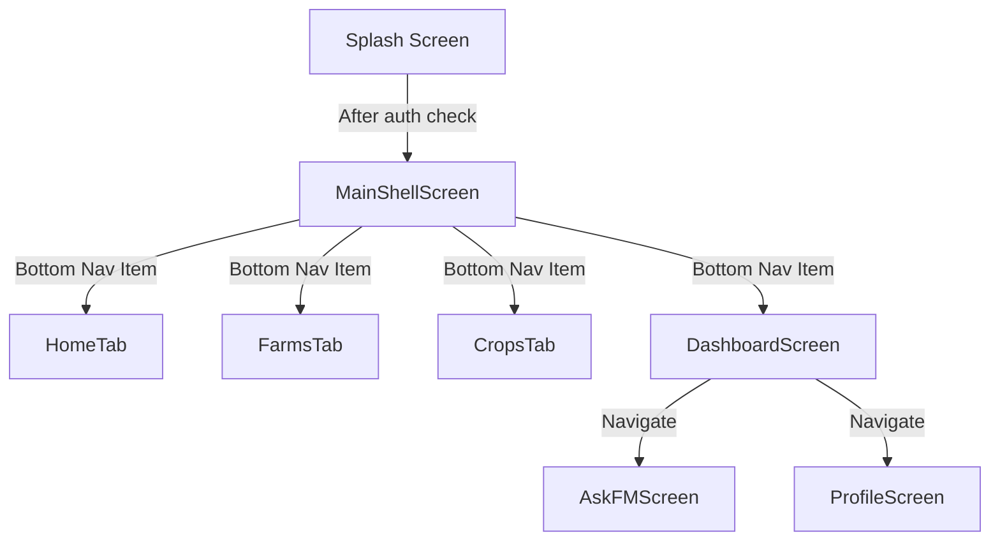

# Frontend - Flutter Mobile Application

## App Entry Point

`mobile/lib/main.dart` - Initializes the Flutter app with router and theme configuration.

## Navigation & Routing

The app uses a custom router configuration:

```
lib/lib/app/router/app_router.dart
```

### Route Structure

| Route | Screen/Widget | Purpose |
|-------|--------------|---------|
| `/` | MainShellScreen | Shell scaffold with bottom navigation |
| `/home` | HomeTab | Main home/dashboard screen |
| `/farms` | FarmTab | Farm management screen |
| `/crops` | CropsTab / individual crop screens | Crop management |
| `/dashboard` | DashboardScreen | Central overview with cards |
| `/ask-fm` | AskFMScreen | AI-powered Q&A with FarmMate |
| `/profile` | ProfileScreen / EditProfileScreen | Farmer profile management |
| `/onboarding` | Onboarding screens | New user onboarding |
| `/splash` | SplashScreen | App launch screen |

### Navigation Flow



## UI Components

### Shared Widgets

| Widget | Location | Purpose |
|--------|----------|---------|
| `ai_greeting_card.dart` | `lib/shared/widgets/` | AI-generated greeting display |
| `ai_chat_bubble.dart` | `lib/shared/widgets/` | AI chat message bubble styling |

### Screen Categories

#### Authentication Screens

| Screen | Route | Description |
|--------|-------|-------------|
| SplashScreen | `/splash` | App launch, auth state check |
| LoginScreen | `/login` | User login form |
| RegisterScreen | `/register` | User registration form |
| PostLoginOnboardingScreen | `/onboarding` | Post-login onboarding flow |

#### Farmer Feature

| Screen | Route | Key Data |
|--------|-------|-----------|
| ProfileScreen | `/profile` | Farmer profile display |
| EditProfileScreen | `/profile/edit` | Profile editing with form validation |

#### Farm Feature

| Screen | Route | Key Data |
|--------|-------|-----------|
| AddFarmScreen | `/farms/add` | Farm creation form |
| FarmTab | `/farms` | List of farmer's farms |
| AddFarmSheet | `/farms/sheet` | Farm creation sheet (bottom) |
| AddFarmForm | `/farms/form` | Farm form with validation |

#### Dashboard Feature

| Screen | Route | Key Data |
|--------|-------|-----------|
| DashboardScreen | `/dashboard` | Central overview |
| HomeTab | `/home` | Home tab within shell |
| MainShellScreen | `/` | Bottom navigation shell |
| Tabs (placeholder) | Various | farms, crops, dashboard, ask_fm |

#### Crops Feature

| Screen | Route | Key Data |
|--------|-------|-----------|
| CropsTab | `/crops` | Crops list |
| CropDetailScreen | `/crops/:id` | Crop details |
| CropCreateScreen | `/crops/create` | Create new crop |
| EditCropScreen | `/crops/:id/edit` | Edit crop info |
| AddCropScreen | `/crops/add` | Add crop screen |

#### Weather Feature

| Screen | Route | Key Data |
|--------|-------|-----------|
| Weather provider screens | Various | Weather data display |

#### Ask FM Feature

| Screen | Route | Key Data |
|--------|-------|-----------|
| AskFMScreen | `/ask-fm` | AI Q&A interface |

## State Management

The app uses **Provider** for state management:

### Key Providers

| Provider | Module | Purpose |
|----------|--------|---------|
| `auth_provider.dart` | auth | User auth state, token management |
| `farmer_provider.dart` | farmer | Farmer profile state |
| `farm_provider.dart` | farm | Farm state and operations |
| `dashboard_provider.dart` | dashboard | Dashboard data state |
| `crop_provider.dart` | crops | Crop data state |
| `crop_recommendation_provider.dart` | crops | Crop recommendations |
| `weather_provider.dart` | weather | Weather data state |
| `dashboard_provider.dart` | dashboard | Aggregated dashboard data |

### Provider Pattern

```dart
// Example provider pattern
class AuthProvider extends ChangeNotifier {
  User? _user;
  bool _isLoggedIn = false;
  
  User get user => _user;
  bool get isLoggedIn => _isLoggedIn;
  
  Future<void> login(String mobile, String password) async {
    // Auth logic
    _isLoggedIn = true;
    notifyListeners();
  }
  
  Future<void> logout() async {
    _isLoggedIn = false;
    _user = null;
    notifyListeners();
  }
}
```

## Network Layer

### API Client

`lib/core/network/api_client.dart` - Handles all backend API communications.

### Endpoint Patterns

All API calls follow a consistent pattern:

```dart
// Example API call
final response = await http.post(
  Uri.parse('${ApiConfig.baseUrl}/api/v1/auth/login'),
  body: json.encode({
    'identifier': mobile,
    'password': password,
  }),
);
final data = json.decode(response.body);
```

### ApiConfig

`lib/core/config/api_config.dart` - Configuration base URL and endpoints.

## Local Storage

### Token Storage

`lib/core/storage/token_storage.dart` - Manages JWT token persistence using `shared_preferences`.

### Stored Data

- Authentication token
- User ID
- Login status
- Onboarding completion flag

## Responsive Layout

The app adapts to different screen sizes:

- **Mobile**: Single column layout, bottom navigation bar
- **Tablet**: Possible two-pane layouts (in development)
- **Consistent**: Material Design 3 components throughout

## Accessibility

- Touch targets minimum 48dp
- Color contrast following Material Design guidelines
- Screen reader friendly labels on interactive elements
- High contrast mode support through ThemeData

---
*Frontend analysis from codebase as of 2026-11-21. All screen paths verified from actual Flutter source files.*