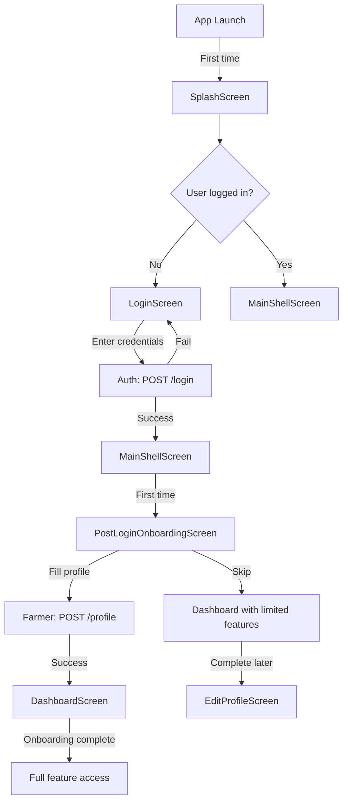
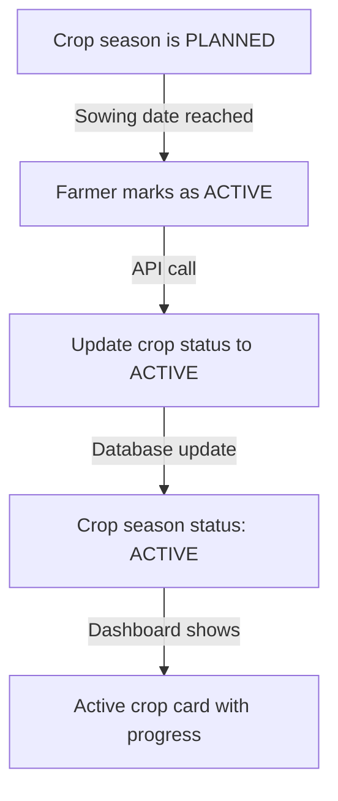
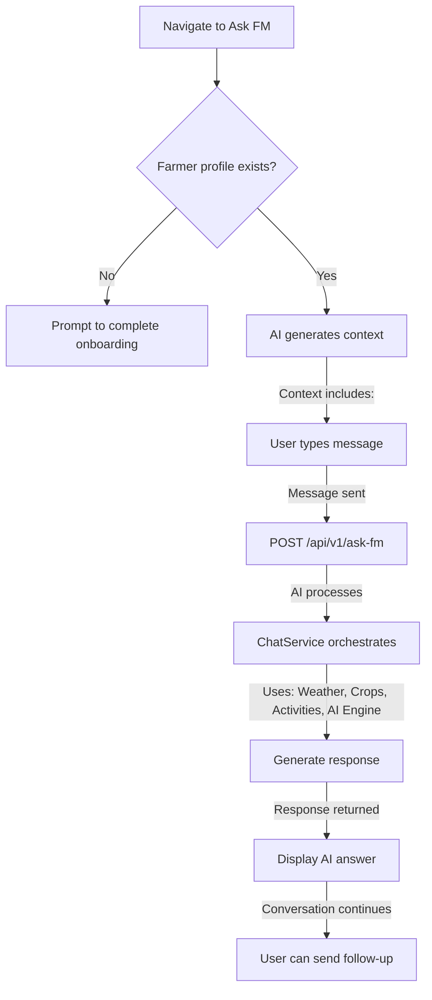
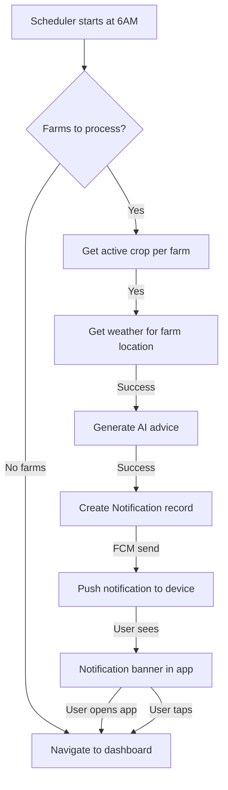

# User Flows

## Onboarding Flow - New User

### Overview
Complete user onboarding from registration to full feature access.

### Steps

| Step | Action | Screens | Backend |
|------|--------|---------|---------|
| 1 | **Register** | SplashScreen → RegisterScreen | `POST /auth/register` |
| 2 | **Login** | LoginScreen | `POST /auth/login` |
| 3 | **Create Farmer Profile** | PostLoginOnboardingScreen | `POST /farmer/profile` |
| 4 | **Complete Onboarding** | Fill profile form (language, experience) | `PATCH /farmer/profile` |
| 5 | **Full Access** | Dashboard becomes available | All farmer features enabled |

### Detailed Flow



## Daily Farming Flow

### Overview
Typical day-to-day farmer using FarmMate AI.

### Morning (6:00 AM - 9:00 AM)

| Time | Action | System |
|------|--------|--------|
| 6:00 AM | **Scheduler runs** | APScheduler triggers daily job |
| 6:01-6:30 AM | **Weather update** | Weather service fetches current conditions for all farms |
| 6:30-7:00 AM | **AI advisor generated** | Advisor service generates daily farming advice |
| 7:00 AM | **Notification sent** | FCM push notification to farmer's device |
| 7:00-9:00 AM | **Open app** | Farmer sees advisor notification + dashboard |

### Dashboard Flow

```mermaid
flowchart TD
    A[Open App] --> B[MainShellScreen]
    B --> C[DashboardScreen loads]
    C --> D{Farmer has active crop?}
    
    D -->|Yes| E[Show active crop card]
    D -->|No| F[Show prompt to add crop]
    
    E --> G{Weather available?}
    G -->|Yes| H[Display WeatherCard]
    G -->|No| I[Show "Unavailable" weather]
    
    E --> J{AI Advisor available?}
    J -->|Yes| K[Show AdvisorCard with today's advice]
    J -->|No| L[Show "Unavailable" advisor]
    
    E --> M[Show today's activities]
    M --> N[List activities sorted by priority/status]
```

### Throughout Day

| Activity | Action | System |
|----------|--------|--------|
| Check activities | Open dashboard | View today's tasks with priority/status |
| Log activity | Navigate to activity screen | Record activity with status update |
| Ask FarmMate | Navigate to Ask FM | Send message to AI, get response |
| View weather | Pull down to refresh | Get latest weather conditions |
| Receive notifications | Push notifications | FCM delivers weather/advisor updates |

### Evening

| Activity | Action | System |
|----------|--------|--------|
| Review day's activities | Dashboard → Activities | See completed/skipped tasks |
| Plan tomorrow | Crop stage management | Update stage statuses |
| End day | Close app | No scheduled actions until next morning |

## Crop Lifecycle Flow

### Overview
Managing a crop from planning to harvest.

### Planning Phase

```mermaid
flowchart TD
    A[Navigate to Crops] --> B{Add new crop season?}
    B -->|Yes| C[CropCreateScreen]
    C -->|Enter details| D[POST /crop-seasons]
    D -->|Success| E[Crop season created (status: PLANNED)]
    
    B -->|No| G[View existing crops]
    G -->|Select crop| H[Crop detail screen]
```

### Crop Creation

```
User → Select crop name, variety, land area, season, year, sowing date
     ↓
API → POST /api/v1/crop-seasons (with farm_id)
     ↓
Database → CropSeason record created
     ↓
Frontend → Show crop with PLANNED status
```

### Growth Phase (PLANNED → ACTIVE)



### Stage Progression

```
Crop Season (ACTIVE) → Crop Stages (PENDING → ACTIVE → COMPLETED)
                                              ↓
                                        Activities scheduled per stage
                                              ↓
                                        Farmer tracks activity completion
```

### Harvest Phase

```
Crop is HARVESTED → is_active = False
                ↓
Harvested date recorded
                ↓
Crop season history preserved
                ↓
User can plan next crop season
```

## Ask FM / AI Q&A Flow

### Overview
Conversations with AI FarmMate.

### Initiating a Conversation



### Conversation Context

The AI considers:
- Current crop and its stage
- Recent activities
- Weather conditions
- Farmer's profile (location, language)
- Previous conversation history (session-based)

### Session Management

- Each Ask FM conversation is a **session**
- Sessions have TTL (expire after time)
- Expired sessions are cleaned up by scheduler
- Messages persist within session until deletion

## Notification Flow

### Weather/Advisor Notification



### Notification Types

| Type | Trigger | Message Example |
|------|---------|-----------------|
| `AI_ADVISOR` | Scheduler daily run | "Today's AI Advice: Check soil moisture before irrigation" |
| `WEATHER_UPDATE` | Weather data fetched | "Weather: Clear sky, 32°C - Good for field work" |
| `ACTIVITY_REMINDER` | Activity scheduled today | "Reminder: Fertilization scheduled for today" |
| `SYSTEM` | System events | "Your farm data has been updated" |

### Notification Priorities

| Priority | Color | Usage |
|----------|-------|---------|
| `LOW` | Green | Non-urgent information |
| `MEDIUM` | Orange | Important but not critical |
| `HIGH` | Red | Immediate attention required |

---
*User flows documented from codebase analysis as of 2026-11-21. All flows verified from actual source code across backend modules and Flutter screens.*